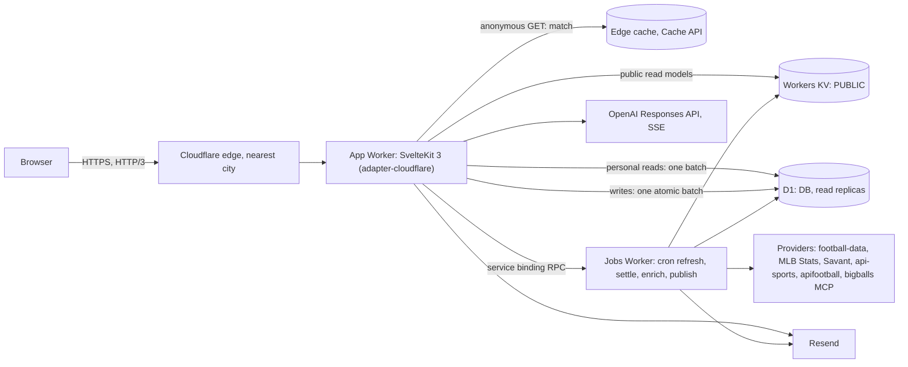

# Matchday Plan: Cloudflare migration spec

| | |
| --- | --- |
| Status | Ready for execution |
| Written | 2026-11-03 |
| Owner | Oscar Espinoza (approves gates G1–G3, runs anything that touches production) |
| Executor | Cursor agents (Agents Window, one ticket at a time, worktree per ticket) |
| Source app | Next.js 16 on Vercel (iad1) + Neon Postgres (us-east-1), repo `Oscar-Espinoza/plan-bet` |
| Target app | SvelteKit 3 on Cloudflare Workers + D1 + Workers KV + edge cache, with a separate jobs Worker |

This is the only document the executor needs. It holds the goal, what must not change, the target design, the ticket breakdown, the review process and, in the appendices, the exact contents of the Cursor config files to create in ticket T00.

---

## 0. Read this first (executor)

1. **Precedence.** For stack, tooling and file layout, this spec overrides `AGENTS.md`, `docs/workflow.md` and `PERFORMANCE.md`. Product behaviour, data rules, money rules, buddy rules and design rules in `AGENTS.md`, `DESIGN.md`, `PRODUCT.md` and `docs/{data,wagers,buddy,history}.md` still bind, unchanged. If this spec and one of those rules disagree, **stop the ticket** and record `BLOCKED: <rule> vs <spec section>` in `docs/migration-log.md`. Do not pick one yourself.
2. **Your training data is older than this stack.** SvelteKit 3.1 (released Oct 2026), `@sveltejs/adapter-cloudflare` 8, Vite 8, Better Auth 1.7 and Wrangler 4.15x are newer than most model training. Before writing code against them, read:
   - SvelteKit 3 migration guide: `https://svelte.dev/docs/kit/migrating-to-sveltekit-3/llms.txt` (`$lib` → `#lib`, config moved from `svelte.config.js` into the Vite plugin, `$app/environment` renamed to `$app/env`, `$app/stores` removed, `invalidateAll` → `refreshAll`, `json`/`text` helpers deprecated).
   - Svelte and SvelteKit docs: `https://svelte.dev/llms.txt` (follow its links per topic).
   - Adapter: `https://svelte.dev/docs/kit/adapter-cloudflare/llms.txt`
   - Better Auth: `https://www.better-auth.com/docs/integrations/svelte-kit.md`, `.../docs/concepts/session-management.md`, `.../docs/adapters/drizzle.md`
   - D1: `https://developers.cloudflare.com/d1/` (limits, `batch()`, read replication and the Sessions API)
   - Workers: limits, Cache API, Cron Triggers, service bindings (RPC), `nodejs_compat`
   Oscar adds these as Cursor `@Docs` entries in setup (§6.1). Cite the doc you followed in the ticket plan when you use an API you have not seen before.
3. **Legacy code is the behaviour reference.** T00 moves the whole Next.js app into `legacy/` unchanged. Port behaviour from `legacy/src/...`. Port pure logic verbatim where it has no framework dependency (markets, contracts, normalizers, buddy validation, seed). Don't redesign working logic during a port.
4. **Work happens ticket by ticket** (§5), following the loop in §6.3. One ticket is one branch, one PR into `cf/main` and one entry in `docs/migration-log.md`.

---

## 1. Goal and success criteria

**Goal:** the same product on a stack where public pages come from the edge in tens of milliseconds, there are no cold starts, signed-in pages render at the edge with one database round trip, and the browser downloads far less JavaScript.

**Why the current stack is slow** (measured 2026-11-03 from Oscar's machine, which routes through São Paulo):

| Request | Time to first byte |
| --- | --- |
| `/` cold | 1.98 s |
| `/` warm | 0.45–0.55 s |
| `/rules` cold | 1.88 s |
| `/api/health` cold | 1.63 s |
| One Neon query | 11 ms |

Every page is rendered fresh: the root layout reads `headers()` and pages are `force-dynamic`. Every response is `cache-control: private, no-cache, no-store` with `x-vercel-cache: MISS`, rendered in iad1. The database is not the bottleneck.

**Budgets.** Measure each one with the method shown. A missed budget is recorded in the migration log with the number, and Oscar decides. A miss is a review blocker only if it is more than 25% over the target.

| Metric | Baseline | Target | How measured |
| --- | --- | --- | --- |
| Anonymous `/` TTFB, edge cache hit | 450–550 ms | ≤ 60 ms median | `scripts/ttfb.sh` (10 runs, median) from Oscar's machine, on the custom domain |
| First request after a deploy | ~1.9 s | ≤ 300 ms | same script, first run after deploy |
| Signed-in `/you` TTFB | n/a | ≤ 250 ms median | same script with a session cookie |
| JS (gzip) for the `/` first load | 210 KB | ≤ 60 KB | `scripts/budget.mjs` |
| JS (gzip) for a game page first load | 211 KB | ≤ 80 KB | `scripts/budget.mjs` |
| Lighthouse mobile performance, `/` and a game page | 92 / 96 | ≥ 98 | Lighthouse 12 mobile, median of 3, production build |
| LCP (simulated) | 3.39 s / 2.85 s | ≤ 2.0 s | same |
| CLS | 0.000 | ≤ 0.005 | same |
| Warm match click to rendered content | 13 ms | ≤ 16 ms | method in `legacy/PERFORMANCE.md` |

---

## 2. What must not change

### 2.1 Product surface

- **Routes:** `/`, `/games/[id]`, `/groups`, `/groups/new`, `/groups/[slug]`, `/groups/accept/[token]`, `/you`, `/rules`, `/sign-in` and `/system`. `/bets` and `/account` redirect permanently to `/you` and keep the querystring.
- **API paths, methods and JSON envelopes** (`{ data }` / `{ error: { code, message, requestId } }`) for the routes listed in Appendix I. The one exception is the auth handler path, which follows Better Auth (callbacks stay at `/api/auth/callback/<provider>`).
- **Copy in English and Spanish:** `legacy/src/lib/messages.es.json` and the translator in `legacy/src/lib/locale*.ts`. Locale comes from the `locale` cookie, otherwise from `Accept-Language`.
- **Visuals:** `DESIGN.md` is the authority. Port `globals.css` and `matchup.css` as they are. The pixel geometry of the header, tabs, scorebug, slip, rows and nav stays within 1 px at 320, 390 and 1280 px, in both languages.
- **Browser storage:** the localStorage key `matchday-plan:v1` keeps `version: 3` and the guard in `legacy/src/lib/storage.ts` exactly, so returning visitors keep their tour state and buddy conversation id. The `sport` cookie keeps working as today.
- **Route IDs:** team-perspective route ids (`mlb-{gamePk}-new-york-yankees`) and the Session 01 demo route ids still resolve.
- **Time display:** times render on the server in the viewer's zone, then switch to the browser's zone after hydration. They are never blank before JS runs, and `suppressHydrationWarning` is never used.

### 2.2 Data and money invariants (from `docs/data.md`, `docs/wagers.md` and `docs/buddy.md`)

- Layering stays one-directional: provider adapter → service → route/page. UI never imports provider raw types, and everything crossing a layer goes through the contracts module.
- Provider payloads are validated with Zod and normalized before rendering or persistence. The fallback chain is fresh live → expired last-known-good (`stale`) → seeded `demo`. A failed refresh never overwrites last-known-good. Missing data renders "Not provided".
- Freshness `mode` is derived at read time from the stored expiry. TTLs: team 7 d, schedules and standings 6 h, game snapshots 1 h, refresh lease 2 min.
- **Wagers and `credit_entries` are append-only.** There is no update or delete path for them.
- Balance is the sum of the ledger and is never a stored column.
- A wager's state is derived from whether a `return` entry exists.
- Settlement pays once, enforced by a unique index on `return` rows. It is graded by `gradeSelection` from the provider result alone, and only for terminal game statuses.
- Prices come from the fixed house table and are re-read server-side; client-supplied prices are never trusted.
- The only stake limit is the balance, checked atomically with the debit, together with group membership and game availability.
- Placement is idempotent on `(user_id, idempotency_key)`.
- Bankroll resets are capped at 5 per hour. A reset always inserts a row, even when the delta is 0.
- The starting grant is 1000 credits and is created atomically with the user. It is unique per user.
- No paid AI call happens without a successful quota claim: 30 turns per session and 100 per IP hash, per UTC day. Metering fails closed.
- Every buddy `[fact-id]` must resolve, or the reply is retracted. The buddy names a selection and never places one.
- Raw IPs are never stored, only salted hashes.
- Secrets stay server-only. Missing provider tokens or a missing OpenAI key must not break a build or a page.

### 2.3 Scope (unchanged)

Fictional credits only. The app has no real money, bookmakers, push or marketing notifications, live play-by-play or public social feeds. Group activity emails (opt-out per membership) and comment shame/slander votes stay. Don't add features during the migration.

---

## 3. Target architecture

### 3.1 Overview



### 3.2 Stack

| Layer | Choice (latest stable at start; pin exact versions in T00) |
| --- | --- |
| Runtime | Cloudflare Workers, **Workers Paid plan** (the free plan's 10 ms CPU limit is too low for SSR), `compatibility_flags: ["nodejs_compat"]` |
| Framework | SvelteKit 3.1.x, Svelte 5 (runes), Vite 8, `@sveltejs/adapter-cloudflare` 8.x (Workers Static Assets) |
| CSS | Existing CSS ported as-is, with Tailwind 4 via `@tailwindcss/vite` |
| Validation | Zod 4, **server only** (rule unchanged: no zod in client code) |
| ORM / DB | Drizzle ORM (sqlite dialect, D1 driver), drizzle-kit `generate` only, migrations applied with `wrangler d1 migrations apply` |
| Database | Cloudflare D1, with read replication enabled through the Sessions API |
| Public read models | Workers KV namespace `PUBLIC` |
| HTML cache | Workers Cache API (`caches.default`). **This requires a custom domain**: it does nothing on `*.workers.dev` |
| Auth | Better Auth 1.7.x, Drizzle sqlite adapter, Google and GitHub, `session.cookieCache` (compact, 5 min) |
| Jobs | Second Worker `matchday-jobs` with Cron Triggers and a `WorkerEntrypoint` RPC class, sharing code from `src/lib/server` |
| AI | OpenAI Responses API over fetch, streamed as SSE through the Worker (port `legacy/src/providers/openai/client.ts`) |
| Email | Resend over fetch, sent in `waitUntil` |
| Package manager | pnpm 11, Node 24 for tooling |

### 3.3 Request paths

1. **Anonymous public GET** (`/`, `/games/[id]`, `/rules`, `/system` and their `__data.json`): edge cache lookup. On a hit, return it (`x-mp-cache: HIT`). On a miss, SSR from the KV read models (memoized per isolate for 10 s, falling back to D1 last-known-good and then the demo seed), store the result in the cache in `waitUntil`, and return it (`x-mp-cache: MISS`).
2. **Signed-in GET:** cache is bypassed. SSR uses KV for public data plus **one** `db.batch([...])` for personal data (session check through the cookie cache, balance, open count and page data) on a D1 Sessions API session. The session's bookmark is kept in the `mp_d1b` cookie so users always read their own writes.
3. **Mutation** (POST/PATCH/DELETE under `/api`): origin check, then `requireAccount`, then body parse. **All business predicates run inside one atomic `db.batch()`** (§3.7). Follow-up work (emails, publish) goes to `waitUntil`. The handler sets `mp_d1b` from the session bookmark.
4. **Buddy:** POST, quota claim (one conditional insert), then the OpenAI stream proxied as SSE, then validation on completion and a terminal frame, exactly as today.
5. **Jobs:** cron, then a lease (`ingestion_runs` partial unique index), then providers, Zod validation, normalization and D1 upserts per team. On success, rebuild the affected KV read models and bump `publish:version`.

The request path never calls a provider. When a read model has expired past its TTL, the app calls `env.JOBS.refresh(sport)` in `waitUntil`; the lease dedupes concurrent calls.

### 3.4 Edge HTML cache (privacy-critical, Tier A review)

- **Eligible** only when all of these hold: the method is GET; the path is in the allowlist (`/`, `/games/*`, `/rules`, `/system` and the `__data.json` variants of those); **no Better Auth session cookie** is present; the response status is 200; the response has **no `Set-Cookie`**; and the route did not opt out.
- **Cache key:** `https://cache.matchday.internal/v{publishVersion}/{locale}/{tz}/{sport}{pathname}?{sorted query}`.
  - `locale` is `en|es`, from the cookie or `Accept-Language`.
  - `tz` is the `tz` cookie, else `request.cf.timezone`, else `UTC`. The client writes the `tz` cookie after hydration when it differs.
  - `sport` is the resolved board filter (used on `/` only).
  - `publishVersion` is read from KV `publish:version` and memoized per isolate for 10 s. Bumping it makes every old entry unreachable, so no purge API is needed.
- **TTL:** 60 s (stored response has `Cache-Control: public, s-maxage=60`). The browser-facing header is `Cache-Control: public, max-age=0, must-revalidate`. **Never `no-store` on HTML**, because that blocks the back/forward cache. Signed-in HTML is `private, no-cache`.
- Freshness labels are computed at render time, so a cached label can be at most 60 s old. That is accepted.
- Debug headers on HTML responses: `x-mp-cache: HIT|MISS|BYPASS` and `x-mp-version`.

### 3.5 Public read models (KV `PUBLIC`)

| Key | Content | Writer |
| --- | --- | --- |
| `board:v1` | `BoardData` for all four teams (team, games, stored expiry), the shape `legacy/src/app/page.tsx` passes to `Slate` | jobs, after refresh or settle |
| `game:v1:{canonicalGameId}` | public `GameSnapshot`, fixture context facts and the stored expiry | jobs, after refresh or enrich |
| `routes:v1` | map of route id → canonical game id (team-perspective ids and demo ids) | jobs |
| `publish:version` | integer, incremented after a successful publish | jobs |

Values store expiry timestamps, not modes, so freshness is still derived at read time. If KV is missing or invalid, read D1 (last-known-good), then the demo seed. `MATCHDAY_DATA_MODE=demo` serves the seed and skips caches.

### 3.6 D1 schema (port of `legacy/src/db/schema.ts`)

**Type rules:**

| Postgres | D1 / SQLite |
| --- | --- |
| `uuid` | `TEXT`, lowercase canonical, `crypto.randomUUID()` |
| `timestamptz` | `INTEGER` ms since epoch (Drizzle `timestamp_ms`). Pagination orders by `(created_at DESC, id DESC)` |
| `jsonb` | `TEXT` JSON (Drizzle `text({ mode: "json" })`). Add `VIRTUAL` generated columns and indexes where SQL filters on a JSON field (for example `games.status` from `summary`) |
| `pgEnum` | `TEXT` with a `CHECK (col IN (...))` |
| `numeric(6,2)` price | `INTEGER price_hundredths`, with a Drizzle `customType` that exposes a number (1.85) to domain code |
| `numeric(5,1)` line | `INTEGER line_tenths`, also through a `customType` |
| `integer` money | `INTEGER` (64-bit, so aggregates need no bigint dance). Keep the domain constants (`INT4_MAX`, `MAX_STAKE`) unchanged for compatibility |
| partial unique index | supported. `ON CONFLICT` against one must repeat the index's `WHERE`: `ON CONFLICT (wager_id) WHERE kind = 'return' DO NOTHING` (raw SQL where Drizzle can't express it) |
| FK `ON DELETE CASCADE` | supported. D1 enforces foreign keys |

**Tables:** `teams`, `games`, `team_games`, `game_snapshots`, `ingestion_runs`, `groups`, `group_members`, `group_invites`, `wagers`, `credit_entries`, `provider_cache`, `fixture_context`, `game_comments`, `comment_votes`, `buddy_messages`, `buddy_notes`, plus the Better Auth tables `user`, `account`, `session` and `verification`, generated by the Better Auth CLI for Drizzle sqlite. Keep each legacy index, including its partial-index predicate.

**Starting grant:** a SQLite trigger in a migration:

```sql
CREATE TRIGGER user_starting_grant AFTER INSERT ON "user" BEGIN
  INSERT INTO credit_entries (id, user_id, kind, amount, reason, created_at)
  VALUES (lower(hex(randomblob(16))), NEW.id, 'grant', 1000, 'starting grant',
          CAST(unixepoch('subsec') * 1000 AS INTEGER));
END;
```

Use the reason text from `legacy/src/data/credits.ts`. The partial unique index `credit_entries_user_grant_uidx` still guarantees one grant. Account creation and the grant are atomic because the trigger runs inside the user's insert statement.

### 3.7 Concurrency without advisory locks

D1 serializes writes, and `db.batch()` runs as one SQL transaction. **Rule:** each check that legacy code made after taking a lock becomes a SQL predicate inside the write batch. It must never be a read in Worker code before the batch.

| Legacy (`pg_advisory_xact_lock` classid) | D1 replacement |
| --- | --- |
| 4: per-account balance lock (placement, reset) | conditional `INSERT … SELECT … WHERE <predicates>` in one batch (sketch below) |
| 5: group invites (create/reuse link, accept) | conditional statements: `UPDATE group_invites … WHERE id=? AND status='pending' AND expires_at>?`, plus a member insert guarded by `EXISTS` on that invite state; ported from `legacy/src/data/groups*.ts` |
| 6 and 7: buddy session and IP quotas | one `INSERT INTO buddy_messages … SELECT … WHERE (session count today) < 30 AND (ip count today) < 100`. Claimed means `meta.changes === 1` |
| refresh and settle lease | `INSERT` into `ingestion_runs` with `status='running'`, guarded by the partial unique index. Port the stale-lease logic |

Placement sketch (parameter numbering is illustrative; keep each statement under 100 bound parameters):

```sql
-- 1. insert the wager only if every rule holds
INSERT INTO wagers (id, user_id, group_id, canonical_game_id, route_id, sport, market_id, selection_id,
  market_label, selection_label, line_tenths, price_hundredths, stake, potential_return, matchup,
  competition, scheduled_at, prices_version, rules_version, idempotency_key, created_at)
SELECT ?1, ?2, ?3, ...
WHERE (SELECT COALESCE(SUM(amount), 0) FROM credit_entries WHERE user_id = ?2) >= ?stake
  AND EXISTS (SELECT 1 FROM games WHERE canonical_id = ?game AND status = 'scheduled' AND scheduled_at > ?now)
  AND (?3 IS NULL OR EXISTS (SELECT 1 FROM group_members WHERE group_id = ?3 AND user_id = ?2))
ON CONFLICT (user_id, idempotency_key) DO NOTHING;
-- 2. debit only if statement 1 inserted this wager id
INSERT INTO credit_entries (id, user_id, kind, amount, reason, wager_id, created_at)
SELECT ?e, ?2, 'stake', -?stake, ?reason, ?1, ?now WHERE EXISTS (SELECT 1 FROM wagers WHERE id = ?1);
-- 3. read back by (user_id, idempotency_key), and the new balance
```

Use the availability and status predicates from `legacy/src/data/wagers.ts`; the predicate above is only the shape. In the result, a returned wager id different from `?1` is an idempotent replay (200, no second debit, no second email). No row means a rule failed: run read-only queries to choose the error code the legacy route returned. Prices and potential return are computed in the Worker from the house table. The client never sends them.

Settlement: claim the lease, select open wagers joined to terminal games, grade them in the Worker with `gradeSelection`, then insert one `return` row per wager with `ON CONFLICT (wager_id) WHERE kind='return' DO NOTHING`. A failure on one wager is counted and the rest continue. The lease closes in `finally`.

### 3.8 Auth

- Better Auth mounted through the SvelteKit handler. `hooks.server.ts` fills `event.locals.user` and `event.locals.session` using the cookie cache, so most requests don't touch D1.
- Providers are Google and GitHub. Port `isTrustedProviderEmail` from `legacy/src/lib/auth-config.ts`: a Google sign-in requires `email_verified === true`.
- `requireAccount()` keeps its legacy return shape (`ok`, or `reason: "unconfigured" | "unauthenticated"`). `isAuthConfigured()` = `BETTER_AUTH_SECRET` + at least one provider + a `DB` binding. When it's false, sign-in UI is hidden and pages render anonymously.
- Mutation guard order stays: `isSameOrigin`, then `requireAccount`, then `readJsonBody`.
- **Maintenance switch (new, for cutover):** while `MATCHDAY_MAINTENANCE=1`, mutations and sign-in return 503 with code `maintenance`, and the UI shows the existing banner component with a maintenance message (English and Spanish).

### 3.9 Jobs Worker (`workers/jobs/`)

- Cron schedule:
  - `5 * * * *`: refresh both sports in parallel (`Promise.allSettled`).
  - `20 * * * *`: settle.
  - `40 */3 * * *`: enrich fixture context.
  - Each run publishes the read models on success.
- RPC class `Jobs extends WorkerEntrypoint` with `refresh(sport)`, `settle()`, `enrich()` and `publish()`, called from the app through the `JOBS` service binding.
- The app keeps `/api/cron/{refresh,settle,enrich}` (GET and POST, bearer `CRON_SECRET` compared with `crypto.subtle.timingSafeEqual`). They forward to the binding and always return 200 with a summary when authorized, as today.
- Settlement emails are sent from the jobs Worker.
- Shared code in `src/lib/server/{domain,db,providers,data}` must not import `@sveltejs/kit`, `$app/*` or `.svelte` files, so the jobs Worker can bundle it. Verify in T03 that the `#lib` subpath import resolves in the jobs bundle. If it doesn't, use relative imports in shared code.

### 3.10 Frontend

- **Structure:**
  - `src/routes` mirrors the route list.
  - `+page.server.ts` loads only rendered fields; the pattern is `BoardData` and `MatchView` from legacy.
  - Next's `loading.tsx` becomes the navigation preview plus skeletons, driven by `$app/state` `navigating`.
  - `error.tsx` and `not-found.tsx` become `+error.svelte`.
- **Component port:** each legacy client component becomes a Svelte 5 component with runes. Server components become markup inside routes. Keep class names so the CSS ports unchanged. Remove Radix: write accessible dialogs with native `<dialog>` and matching focus management. Replace `lucide-react` with `@lucide/svelte` (tree-shaken per icon) or inline SVG.
- **State:** a runes store replaces Zustand, with the `matchday-plan:v1` guard ported verbatim.
- **Preloading:**
  - The first four visible match links get `data-sveltekit-preload-code="viewport"` and `data-sveltekit-preload-data="hover"`.
  - Other links get `"tap"`.
  - On `navigator.connection.saveData` or a 2g/3g connection, preload only on tap (the legacy behaviour).
- **Instant destination previews** (legacy `navigation-preview.tsx`) are ported: the match card hands its public fields to the destination skeleton through navigation state held in memory.
- **View transitions:** use `onNavigate` with `document.startViewTransition` where supported, cross-fade only, and respect `prefers-reduced-motion`.
- **Service worker** (`src/service-worker.ts`): build assets and fonts are cache-first (immutable). HTML and `__data.json` are network-first, with the last good `/` as the offline fallback. It must not cache anything when a session cookie is present.
- **Fonts:** the same three families (Archivo, IBM Plex Sans, DM Mono), latin subset, woff2 in `static/fonts`, preloaded, with metric-matched fallbacks. Copy the `size-adjust`/`ascent-override` values from a legacy `next build` CSS output, or compute them with `fontaine`.
- **CSS:** port `globals.css` and `matchup.css` as they are; both load with the shell (legacy lesson: the matchup stylesheet suspending a route cost 300 ms). Try inlining the CSS through the SvelteKit inline style threshold. Keep it only if Lighthouse LCP improves; record the result.
- **Images:**
  - Crests stay 160 px. Add AVIF next to WebP with `<picture>`.
  - The stadium image is 800 px AVIF/WebP with `fetchpriority="high"`, preloaded by the page and sent as a `Link` header so Cloudflare Early Hints can send it.
  - Row crests use `loading="lazy"`.
- **OG image and icon:** generate them once at build time with a script and serve them from `static/`. No runtime image generation.
- **Times:** the server renders in the cache-key `tz` and the client switches to the browser zone after hydration. Port `legacy/src/components/local-date-time.tsx` behaviour.
- **Zone speed settings** (Oscar, in the dashboard): Early Hints on, HTTP/3 on, 0-RTT on, Brotli/Zstandard on. **Rocket Loader off** (it breaks hydration). Auto Minify off.

### 3.11 Observability and health

- Workers Logs are enabled on both Workers. The JSON logger is ported with its redaction rules and a `requestId` per request.
- `/api/health` keeps its shape. Schema currency compares the bundled migration file list with the `d1_migrations` table. It also reports the KV `publish:version` and last publish time, plus the provider status from `ingestion_runs`.
- `/system` is ported, including settlement run status and the age of the oldest open wager.

### 3.12 Configuration map

| Legacy | New | Where |
| --- | --- | --- |
| `DATABASE_URL` | D1 binding `DB` (Neon is used only by the export script, run by Oscar) | both Workers |
| `AUTH_SECRET` | `BETTER_AUTH_SECRET` | app secret |
| `NEXT_PUBLIC_SITE_URL`, `VERCEL_PROJECT_PRODUCTION_URL` | `PUBLIC_SITE_URL`, also used as `BETTER_AUTH_URL` | app var |
| `AUTH_GOOGLE_ID/SECRET`, `AUTH_GITHUB_ID/SECRET` | same names | app secrets |
| `CRON_SECRET` | same | both |
| `RATE_LIMIT_HASH_SECRET` | same, **required** (isolates restart often, so there is no per-process salt fallback) | app |
| `OPENAI_API_KEY`, `OPENAI_MODEL` | same | app |
| `FOOTBALL_DATA_API_TOKEN`, `API_FOOTBALL_KEY` / `API_FOOTBAL_KEY` / `DASHBOARD_API_FOOTBALL_KEY` | same, keeping legacy precedence | jobs |
| `RESEND_API_KEY`, `EMAIL_FROM` | same | both |
| `MATCHDAY_DATA_MODE` | same | both vars |
| `x-vercel-ip-timezone` header | `request.cf.timezone` | runtime |
| (none) | `MATCHDAY_MAINTENANCE` | app var |

### 3.13 Rejected alternatives (don't reopen without Oscar)

- **Per-user Durable Objects for wallets.** Microsecond reads, but group activity, leaderboards and settlement query across users. That would force a projection that is written twice on the money path. D1 gives the same single-writer guarantee in one database.
- **Postgres through Hyperdrive.** Keeps the schema, but each personal query is a round trip to us-east-1. D1 `batch()` makes a signed-in page one round trip to the nearest replica.
- **Staying on Next with Cache Components.** Fixes TTFB but keeps the React bundle and cold starts on personal pages.
- **Astro.** Ships less JS on content pages, but the slip, groups, comments and buddy behave like an app. SvelteKit covers both.
- **SvelteKit remote functions.** Not used. Keep REST endpoints with legacy paths and envelopes so contracts can be compared side by side.

---

## 4. Repository layout during the migration

```
legacy/                    Next.js app moved unchanged in T00. Reference only. Excluded from lint, format and typecheck. Deleted in T15.
src/
  app.html  app.d.ts  hooks.server.ts  service-worker.ts
  lib/
    shared/                isomorphic, no zod: types, markets (pure), locale, utils, wager-copy, storage guard
    server/
      domain/              contracts (zod), cache-policy, seed, game-view, grading glue
      db/                  drizzle schema, client(env), repositories
      providers/           ported adapters
      data/                services: sports-data, publish, wagers, credits, settlement, groups, comments, buddy, fixture-context
      auth.ts  edge-cache.ts  logger.ts  env.ts
    components/            Svelte components
    state/                 runes stores
  routes/                  pages and +server.ts endpoints
workers/jobs/              jobs Worker (wrangler.jsonc, src/index.ts)
drizzle/                   NEW sqlite migrations (legacy Postgres ones stay in legacy/drizzle)
scripts/
  budget.mjs  ttfb.sh  build-og.mjs  encode-images.mjs
  migrate/                 export-neon.ts, transform.ts, reconcile.ts (T14)
  verify/                  money-scenario.ts, ledger-invariants.sql (deleted at T15; see §6.4)
static/                    crests, stadium images, fonts, og.png, icons, robots.txt
docs/migration-log.md      one entry per ticket
.cursor/                   rules, agents, hooks, BUGBOT.md, config/bugbot.yaml (Appendices A–G)
wrangler.jsonc
```

---

## 5. Tickets

**Size cap per ticket:** about 8 build pieces and about 40 changed files. Moved files, lockfiles and generated migrations don't count. If the plan step finds a ticket bigger than that, it splits it (`T05a`, `T05b`) and records the split in the log. It does not build an oversized ticket.

**Review tiers** (defined in §6.4):

- **A:** money, auth, privacy and data migration.
- **B:** logic.
- **C:** UI.

**Dependencies and parallel lanes:**

- T00, then T01.
- Then two lanes in parallel: {T02, then T03} and {T04, then T05}.
- T06 after T03 and T05. T07 after T02. T08 after T06 and T07.
- Then T09 in parallel with T10. T11 after T10. T12 after T10.
- Then T13, then T14, then T15.

### T00: Bootstrap and guardrails (Tier B, Oscar gate G1)

- Create branch `cf/main` from `main`. `git mv` the entire app into `legacy/` (including `public/`, `README.md` and `PERFORMANCE.md`), except `.git`, `.codex`, `.cursor`, `.dashboard`, `AGENTS.md`, `DESIGN.md`, `PRODUCT.md` and `docs/`. Later tickets copy the assets they need from `legacy/public` into `static/`.
- Scaffold SvelteKit 3 at the root with adapter-cloudflare 8, TypeScript strict, ESLint, Prettier and svelte-check. Add `pnpm check` (format check, lint, svelte-check, build, `node scripts/budget.mjs`), which ends by printing `CHECK OK <git short sha>`.
- `wrangler.jsonc` for the app and `workers/jobs/wrangler.jsonc` (Appendix H). Oscar creates the `matchday-preview` D1 and KV resources and pastes the IDs.
- Create the Cursor files from Appendices A–G. Add `.gitattributes`: `legacy/** linguist-generated=true`, `drizzle/meta/** linguist-generated=true`, `pnpm-lock.yaml linguist-generated=true`.
- Prepend this banner to `AGENTS.md`: "Migration in progress on `cf/main`. Stack, tooling and layout follow `docs/cloudflare-migration-spec.md`. Rules about Next.js, Neon, Vercel, `next/font` and Drizzle-pg apply only to `legacy/`. Product, data, money, buddy and design rules apply everywhere."
- Create `docs/migration-log.md` (format in §6.5). Add `scripts/ttfb.sh` and `scripts/budget.mjs`.
- Deploy a hello-world page plus `/api/health` (D1 `select 1`) to `matchday-preview` on workers.dev, then record TTFB.
- **Acceptance:**
  - `pnpm check` prints `CHECK OK`.
  - `pnpm --dir legacy build` still succeeds in demo mode.
  - The preview URL answers, and the measured TTFB is logged.
  - The hooks deny a `wrangler deploy` without `--env preview` (show the denial in the log).
- **G1:** Oscar reviews the scaffold, the Cursor config and the measurements before T01.

### T01: Shared domain port (Tier B)

- Port to `src/lib/shared` and `src/lib/server/domain`: `contracts.ts`, `markets.ts`, `cache-policy.ts`, `seed.ts`, `game-view.ts`, `wager-copy.ts`, `locale*.ts` and `messages.es.json`, `utils.ts`, `stable-hash.ts`, `team-logos.ts` with the badge catalog, `sport-preference.ts`, the `storage.ts` guard, `logger.ts`, `api-request.ts` and `api-response.ts` (rewritten to take a `Request` and return a `Response`).
- **Acceptance:**
  - Pure modules are byte-for-byte equal to legacy apart from import paths. List each deviation and its reason in the log.
  - `zod` is not reachable from `src/lib/shared` (the budget script fails the build if a client chunk contains zod).

### T02: D1 schema, migrations and sports repositories (Tier A)

- Drizzle sqlite schema for all tables (§3.6), the starting-grant trigger, generated columns and indexes. Generate migration `0000`.
- `src/lib/server/db/client.ts`: Drizzle from `env.DB`, a Sessions API helper (bookmark in and out), and `batch` helpers.
- Port `sports-repository.ts` and the read side of `sports-data.ts`. Keep the fallback chain, with no provider calls on the request path.
- `pnpm db:migrate:local` and `pnpm db:seed:local` for miniflare.
- **Acceptance:**
  - Migrations apply to a fresh local D1.
  - The schema dump in the log shows each legacy index and its predicate.
  - The grant trigger fires once per inserted user.
  - A second grant insert for the same user is rejected by the unique index (show both results).

### T03: Providers and the jobs Worker (Tier B)

- Port the providers (`football-data`, `mlb-stats`, `baseball-savant`, `api-sports`, `apifootball`, `bigballs` with `mcp-http`) with their timeouts, bounded bodies and `ProviderError`.
- Port the refresh, lease, enrich (`fixture-context`, `fixture-facts`) and per-team transactions as D1 batches.
- Add `publish.ts` (KV read models plus a `publish:version` bump).
- Jobs Worker with cron and the `Jobs` RPC class. App endpoints `/api/cron/*` forward to the RPC.
- **Acceptance:**
  - On preview, a manual `/api/cron/refresh` fills D1 and `board:v1`, and `publish:version` increments.
  - A refresh with an invalid football-data token leaves last-known-good intact and logs a `warn` (show the before and after `game_snapshots` row and the KV value).

### T04: App shell and edge cache (Tier A, because of the cache)

- Root layout: `AppShell` (header, scroller, bottom nav with Games / You / Groups), fonts, CSS, `LanguageProvider`, request clock and time zone, tour bar, refresh-on-visible, `band-height`, demo stamp, `ui/*`, breadcrumb portal, `+error.svelte`, redirects for `/bets` and `/account`, and robots.
- `hooks.server.ts` implements §3.4 exactly, plus locals for locale, tz and auth (stubbed until T07).
- **Acceptance:**
  - With no cookies, a second GET of `/rules` returns `x-mp-cache: HIT`.
  - With a session cookie present (use any `better-auth.session_token` value), the GET returns `BYPASS`, and a response carrying `Set-Cookie` is not stored.
  - Changing `locale` or `tz` changes the key.
  - The header, nav and footer geometry is within 1 px of legacy at 320, 390 and 1280 px in en and es.

### T05: Board and rules (Tier C)

- `/` (Slate grouped by day, sport filter through query and cookie, stadium preload, row crests lazy), `/rules`, `fast-link` preloading rules, and the navigation preview.
- **Acceptance:**
  - Visual parity with production at the three widths in both languages.
  - The sport filter makes no network request.
  - `/` JS stays within budget.
  - Console is clean.

### T06: Game page, public part (Tier C)

- `/games/[id]`: match chrome, scorebug, status ribbon, context blocks, tabs, a bet slip skeleton in the signed-out state, the preview-to-page handoff and `__data.json` caching.
- **Acceptance:**
  - Parity with production for a soccer and a baseball game, both upcoming and finished.
  - An unknown id returns 404 without calling a provider.
  - The game page JS stays within budget.

### T07: Auth (Tier A)

- Better Auth config, the handler, locals, `requireAccount`, `isAuthConfigured`, the origin guard, the maintenance switch, `/sign-in`, the account chip (balance and open count in one batch) and sign-out.
- **Acceptance:**
  - Signing in with Google and with GitHub on preview creates a user with exactly one grant row of 1000.
  - A Google profile with `email_verified: false` is refused.
  - With `BETTER_AUTH_SECRET` unset, sign-in is hidden and pages render.
  - With maintenance on, a POST returns 503 `maintenance`.

### T08: Wagers and credits (Tier A)

- Placement (§3.7 sketch, legacy predicates, idempotency), reset (5 per hour cap, clamping), credit summary, `GET`/`POST /api/bets`, `POST /api/bets/reset`, the bet slip (stake input, sticky bet bar, confirmation, rotation of the idempotency key) and `/you` (balance, record, open and settled history with pagination, record by sport and market).
- **Acceptance:** run `scripts/verify/money-scenario.ts` against local and then preview. It covers:
  - place;
  - the same key twice (one wager, one debit);
  - the same intent with a new key (two wagers);
  - an overdraw (rejected, nothing written);
  - a closed game (rejected);
  - a non-member group (rejected);
  - 20 concurrent placements that together overdraw (balance never below 0);
  - six resets within an hour (the sixth is refused).
  Then `scripts/verify/ledger-invariants.sql` returns zero violation rows, and both scripts print their OK lines.

### T09: Settlement, health and system (Tier A)

- The settle job (lease, terminal games only, grading, a return row with conflict-do-nothing, per-wager failure isolation), `/api/health`, `/system` and settlement emails.
- **Acceptance:**
  - Running settle twice on the same finished game pays once.
  - A `live` game with a score is skipped.
  - A cancelled game voids (stake returned).
  - Health reports `schema: "current"` with `pendingMigrations: 0` on preview.

### T10: Groups (Tier A, because membership gates wagers)

- Create, slug, invite by email or link, accept (a confirmed POST, never on page load), revoke, the notifications toggle, `/groups`, `/groups/new`, `/groups/[slug]` (activity, leaderboard, member wagers), `/groups/accept/[token]` and emails in `waitUntil`.
- **Acceptance:**
  - Accept and revoke racing on the same invite never both succeed.
  - A non-member gets 404 on the group page and on its API.
  - A member who turns notifications off receives no activity email (check the Resend calls in logs).

### T11: Comments and votes (Tier B)

- One comment per phase per user per game per group, replies, and shame/slander votes with optimistic UI and rollback.
- **Acceptance:**
  - The unique constraint holds.
  - A non-member can't read or post.
  - A failed vote rolls back in the UI.

### T12: Buddy (Tier B, with the money auditor on the quota code)

- Port `buddy.ts`, `buddy-repository.ts`, `buddy-prompt.ts`, `buddy-validation.ts`, the OpenAI client, SSE streaming, retraction, notes, `DELETE /api/buddy`, the launcher and the dialog (lazy-loaded on open).
- **Acceptance:**
  - The 31st turn in a session on one UTC day is refused before any OpenAI call.
  - With the key missing, the deterministic reply works.
  - An unresolvable `[fact-id]` retracts the reply.
  - No `[`…`]` flashes while streaming.

### T13: Speed pass and full parity sweep (Tier C)

- Service worker, view transitions, preload tuning, Early Hints `Link` headers, AVIF, font subsetting check, the CSS inline experiment, and OG and icon assets.
- Measure §1 on preview with the custom domain, or on workers.dev with the cache rows marked "n/a until domain".
- Run a parity sweep of each route at 320, 390 and 1280 px in en and es against production.
- **Acceptance:** the budget table is filled in the log with numbers. Parity issues found are fixed or listed for Oscar.

### T14: Data migration tooling and rehearsal (Tier A, Oscar gate G2)

- `scripts/migrate/export-neon.ts` (read-only `SELECT`s to NDJSON in the gitignored `migration-out/`; **Oscar runs it**).
- `transform.ts` (type rules from §3.6; Auth.js `users` and `accounts` map to Better Auth `user` and `account`, with ids preserved, `provider` → `providerId` and `providerAccountId` → `accountId`; sessions and verification tokens are **not** migrated, so everyone signs in again). It emits `import.sql`, which starts with `PRAGMA defer_foreign_keys = true;`, **drops `user_starting_grant` before inserting users and recreates it at the end** (otherwise every imported user gets a second grant and the import fails on the unique index), and chunks statements under 100 KB.
- `reconcile.ts` compares Neon with D1, per user (balance, wager count, open wagers, stake sum, return sum) and per table (row counts), and prints `RECONCILE OK users=N` only on an exact match.
- Rehearse against `matchday-preview` with a real export.
- **Acceptance:** the rehearsal log shows `RECONCILE OK`, and the timing of each step is recorded.
- **G2:** Oscar reviews the rehearsal before T15.

### T15: Cutover and cleanup (Tier A, Oscar gate G3; Oscar runs the production steps)

- Runbook in §7. After a stable week: delete `legacy/` and `scripts/verify/`, and rewrite `AGENTS.md`, `docs/workflow.md`, `docs/data.md`, `docs/architecture.md` and `PERFORMANCE.md` for the new stack. Keep each invariant's wording.
- **Acceptance:**
  - Production health is `current`.
  - `RECONCILE OK` on production.
  - The budget table is re-measured on production.
  - The docs no longer mention Next, Neon or Vercel, except in history.

---

## 6. How the work is done in Cursor

### 6.1 One-time setup (Oscar)

1. Cursor 3.x, Agents Window. Use a plan that includes the Claude models below and Bugbot.
2. **Settings, then Indexing & Docs:** add the doc URLs from §0.2 as `@Docs`.
3. **Settings, then Git & PRs:** turn on Agent Review, set it to manual, default depth Deep.
4. Install Bugbot on `Oscar-Espinoza/plan-bet`. Bugbot reads `.cursor/config/bugbot.yaml` from the PR's **base** branch, so T00 commits it straight to `cf/main` before the first PR.
5. Cloudflare:
   - Workers Paid plan.
   - `wrangler login` on this machine.
   - Create the `matchday-preview` D1 and KV now. Create `matchday-prod` at T15.
   - Turn on D1 read replication for both.
   - For the cache budget: a custom domain on Cloudflare (see §8, decision D1).
6. Set the preview secrets yourself (`wrangler secret put … --env preview`). The guard hook blocks agents from setting non-preview secrets.
7. Use no Cursor marketplace plugins or extra skills. The repo files in Appendices A–G are the whole configuration.

### 6.2 Model roles

This migration doubles as a trial of two non-Anthropic builders. **DeepSeek and GLM build; Claude Opus 5.5 plans, checks and reviews.** Opus never writes product code unless Oscar says so for a specific ticket.

Model IDs follow Cursor's `id[option=value]` form. Confirm the exact IDs in the model picker. In Cursor Settings → Models, turn on **DeepSeek V4.1 Flash 1017** and **GLM 5.2**; both are hidden by default. Claude Opus 5.5 needs Max Mode on legacy request plans.

| Role | Model | Why |
| --- | --- | --- |
| Planner (Plan Mode, one plan per ticket) | Claude Opus 5.5 | A precise plan is what makes a cheaper builder succeed |
| Builder, even-numbered tickets (T00, T02 … T14) | GLM 5.2 (`glm-5.2-max`) | Builder under trial (GLM 5.3 is not available in the Cursor CLI) |
| Builder, odd-numbered tickets (T01, T03 … T15) | DeepSeek V4.1 Flash 1017 (`deepseek-v41-flash-1017-max`) | Builder under trial |
| `verifier` subagent (read-only) | Claude Opus 5.5 | A different vendor from both builders, so its check is independent |
| `money-auditor` subagent (read-only, Tier A only) | Claude Opus 5.5 | Invariant and race checks on money, auth and cache code |
| Codebase search | built-in Explore subagent | Keeps search output out of the main context |

Alternating by ticket number gives each builder money, logic and UI tickets: GLM 5.2 gets T02, T04, T08, T10 and T14; DeepSeek gets T07, T09 and T15.

**When a builder is stuck.** A builder is stuck when the gate fails 3 times on the same cause, or when review round 2 still blocks on scope. Record it in the scorecard, then hand the ticket to the **other** trial builder with the review findings attached. If both get stuck, mark the ticket `BLOCKED` and ask Oscar. Don't hand it to Opus.

**Sandbox.** In an earlier bake-off (lessons ledger C-2026-10-26-b), a DeepSeek agent edited Oscar's main checkout from a different folder. So builders run only in Cursor worktrees. After each ticket, the verifier confirms that `git -C /home/oscar/Projects/plan-bet status --porcelain` matches the snapshot taken before the ticket started. Any change outside the worktree is a BLOCK and goes on the scorecard.

### 6.3 The ticket loop

1. **Plan.** Start a new chat in Plan Mode with Claude Opus 5.5. Snapshot `git status --porcelain` of the main checkout for the sandbox check (§6.2).
   > "Plan ticket Txx from docs/cloudflare-migration-spec.md §5. Read the legacy files it names. List each file to create or change, the build pieces, the legacy behaviours being ported, and the acceptance commands. Stop and split if it exceeds 40 files or 8 pieces."

   Save the plan to the workspace as `.cursor/plans/Txx.md`.
2. **Build.** Click Build, switching to the ticket's builder (GLM 5.2 for even tickets, DeepSeek V4.1 Flash for odd ones). Don't fix the builder's code yourself from the Opus chat: findings go back to the builder, so the scorecard measures the builder. Run it in a **worktree** on branch `cf/Txx-<slug>` off `cf/main`. When a build goes wrong, revert and refine the plan rather than patching through follow-up prompts (Cursor's own guidance).
3. **Gate.** The `stop` hook (Appendix F) runs `pnpm check` whenever source changed, and sends failures back to the agent automatically (up to 3 loops). A ticket can't finish with a red gate.
4. **Verify:**
   > "Use the verifier subagent on ticket Txx."

   It runs the ticket's acceptance commands, drives the app in Cursor's browser at 390 and 1280 px in en and es, compares the result with production where parity applies, and returns PASS or BLOCK with evidence.
5. **Audit (Tier A only):**
   > "Use the money-auditor subagent on this branch."

6. **Agent Review:** `/agent-review`, Deep for Tier A and B, Quick for Tier C, comparing against `cf/main`.
7. **PR** into `cf/main`. Bugbot reviews it. Fix the findings that are real defects. Reply to the others with the reason.
8. **Log** the ticket in `docs/migration-log.md` (§6.5), then ask Oscar to merge. Oscar merges. Agents never merge to `cf/main` or `main`.

### 6.4 Review rules

**The review stack, in order:**

1. The stop-hook gate (`CHECK OK`).
2. The verifier subagent (Opus 5.5, a different vendor from both builders).
3. The money auditor (Tier A).
4. Agent Review.
5. Bugbot on the PR.
6. Oscar at gates G1–G3 and at each merge.

**Rounds:**

- A ticket gets at most **2 full review rounds**.
- After round 2, only defects inside the ticket's scope block: a broken acceptance item, a §2 invariant, security or privacy. Anything else goes to `FOLLOWUPS` in the log.
- Duplication blocks only when it causes a defect.
- Reviewers are told what does not exist yet. Behaviour owned by a later ticket (listed in §5) is never a finding.

**Evidence must be positive:**

- A gate passes on `CHECK OK <sha>` for the reviewed commit.
- A money scenario passes on its OK line plus zero invariant violations.
- Reconcile passes on `RECONCILE OK`.
- A missing line, a parse failure or "no errors seen" counts as FAIL.

**About verification scripts:** `docs/workflow.md` bans test suites, and that rule stays for the product. `scripts/verify/*` is migration tooling, not a test suite. It has no framework, it is run by hand or by the verifier, and T15 deletes it. Browser checks use Cursor's built-in browser tool. Don't add Playwright, Vitest or any other test framework.

### 6.5 Migration log format (`docs/migration-log.md`)

```
## Txx <title> — <date> — <PASS | BLOCKED | SPLIT>
Branch / PR: cf/Txx-slug / #NN   Models: plan <m>, build <m>, verify <m>
Builder scorecard: see §6.6 (one row added to the table at the top of the log)
Files: <n changed>   Pieces: <n>
Ported from: legacy/src/... (list)
Deviations from legacy: <each, with reason> | none
Acceptance: <each item → command → result line>
Budgets touched: <metric: value>
Review: gate CHECK OK <sha>; verifier <PASS/BLOCK + round>; auditor <…>; agent review <…>; bugbot <n findings, n fixed, n declined + why>
FOLLOWUPS: <items> | none
```

### 6.6 Builder scorecard (DeepSeek vs GLM)

The top of `docs/migration-log.md` holds one table with a row per ticket attempt. Opus fills it in after the verifier and auditor finish, using counts from the hook loops, review reports, Bugbot and Cursor's usage dashboard. It records facts only; the comparison happens at the end.

| Column | What to record |
| --- | --- |
| Ticket, tier, builder | e.g. `T08, A, GLM 5.2` |
| Plan followed | yes / partly / no; note where it went off plan |
| Gate loops | stop-hook follow-ups before `CHECK OK` (0–3) |
| Review rounds | full rounds until PASS (verifier + auditor + Agent Review) |
| Findings by severity | blocker / major / minor, counted across verifier, auditor, Agent Review and Bugbot |
| Invariant breaks | §2 rules broken in any round, named (e.g. "read balance before batch") |
| SvelteKit 2 slips | count of `$lib`, `$app/stores`, `svelte.config.js` and similar |
| Invented APIs | calls to functions, options or bindings that don't exist |
| Sandbox | clean / violation (§6.2) |
| Outcome | PASS / handed to other builder / BLOCKED |
| Wall time, cost | from the first build prompt to PASS; USD from the usage dashboard |

After T08 and after T15, Opus adds a short comparison under the table: the totals per builder, the kinds of mistakes each one repeats, and which ticket types each handled well. It cites rows, not impressions. Oscar uses it to decide the builder split for the rest of the migration (after T08) and for future projects (after T15).

### 6.7 Stop conditions (record in the log and stop the ticket)

- This spec contradicts a §2 rule.
- A ticket is over the size cap after the plan step (`SPLIT`).
- A needed legacy behaviour is ambiguous. Quote the code and ask; don't guess.
- A budget is more than 25% over after one tuning attempt.
- An action needs production access, secrets or a paid change.
- The gate fails 3 times on the same cause.

### 6.8 Forbidden actions (also enforced by the shell hook where possible)

- Deploying anything not marked `--env preview`.
- `wrangler d1 execute|migrations apply` or `wrangler kv … put|delete` against a production resource.
- `wrangler secret put|delete` outside `--env preview`.
- Any command that contains `DATABASE_URL=`, or runs `psql`, `pg_dump` or `vercel`.
- `drizzle-kit push` or `drizzle-kit migrate`.
- `git push` to `main` or `cf/main`, `git push --force`, `git reset --hard` or `git clean -f`.
- `rm -rf` on a path outside the worktree.
- Editing `legacy/` after T00, except to read it.
- Editing `.codex/`, `.claude/` or `~/.cursor`.

---

## 7. Data migration and cutover runbook (T15; Oscar runs the production steps)

**Prerequisites:**

- G2 passed.
- The custom domain is active on Cloudflare.
- Google and GitHub OAuth apps have the new callback URLs.
- Production D1 and KV exist and migrations are applied to the empty production D1.
- Production secrets are set.
- The jobs Worker is deployed and one manual refresh has been published, so public pages are live on the new domain.

| # | Step | Who | Check |
| --- | --- | --- | --- |
| 1 | Set `MATCHDAY_MAINTENANCE=1` on production and deploy | Oscar | POST returns 503 `maintenance` |
| 2 | Deploy a Vercel build whose only job is a 308 redirect from each path to the new domain. Legacy writes stop here | Oscar | the old URL redirects |
| 3 | `export-neon.ts` (final export) | Oscar | NDJSON row counts logged |
| 4 | `transform.ts`, then `wrangler d1 execute matchday-prod --remote --file migration-out/import.sql` | Oscar | the command exits 0 |
| 5 | `reconcile.ts` against production | Oscar | `RECONCILE OK users=N` |
| 6 | Set `MATCHDAY_MAINTENANCE=0` and deploy | Oscar | sign in, place a 1-credit wager, see the balance |
| 7 | Watch Workers Logs and `/api/health` for 24 h, then measure budgets | Oscar + agent | log entry |

**Rollback:**

- **Before step 6:** remove the Vercel redirect (step 2). Legacy and Neon are untouched.
- **After step 6:** new writes exist only in D1, so fix forward.
- Keep Neon unchanged and paused for 30 days, then delete it.
- D1 Time Travel gives 30-day point-in-time recovery on Workers Paid.

---

## 8. Open decisions (default in use; Oscar can override)

| ID | Question | Default |
| --- | --- | --- |
| D1 | Production domain. The edge HTML cache needs a custom domain on Cloudflare, and `plan-bet.vercel.app` can't point there | Build and preview on `*.workers.dev`. Cache budgets are "n/a until domain". T15 is blocked until a domain exists |
| D2 | Workers Paid ($5/month) | Assumed |
| D3 | Personal data store | D1 (§3.13) |
| D4 | `scripts/verify/*` after cutover | Deleted in T15 (the project has no tests) |
| D5 | Forced re-sign-in at cutover (sessions are not migrated) | Accepted. Show a one-line banner for a week |

## 9. Risks

| Risk | Mitigation |
| --- | --- |
| Models write SvelteKit 2 code (`$lib`, `$app/stores`, `svelte.config.js`) | §0.2 docs; a `svelte-ui.mdc` rule lists the renames; svelte-check and the build fail on removed modules |
| A personal page lands in the shared cache | §3.4 eligibility; T04 acceptance; Tier A review; the verifier checks with a session cookie |
| D1 read replication is still in public beta | Writes always go to the primary. If a replica misbehaves, drop `withSession` and use the plain binding (same code, one round trip to the primary) |
| SSR CPU on Workers | Measure `cpuTime` in Workers Logs in T05 and T06, keep load functions lean, and pass only rendered fields |
| KV propagates in about 60 s | Freshness labels are computed at render; HTML TTL is 60 s; accepted |
| `Date.now()` doesn't advance during CPU-only work in Workers | Timestamps are taken after I/O; durations are measured across I/O only |
| Better Auth account mapping | T14 rehearsal: sign in to the preview with a migrated Google and GitHub account |
| Scope creep during the port | §2.3; reviewers flag feature additions as defects |

---

## Appendix A: `.cursor/rules/migration.mdc`

```md
---
description: Matchday Plan Cloudflare migration — architecture, invariants, workflow
alwaysApply: true
---
- The spec is docs/cloudflare-migration-spec.md. Read the section for your ticket before planning. legacy/ is the behaviour reference and is read-only.
- Stack: SvelteKit 3 + Svelte 5 runes on Cloudflare Workers (adapter-cloudflare 8), D1 via Drizzle sqlite, KV `PUBLIC`, Cache API, Better Auth, jobs Worker in workers/jobs. Never write Next.js, React, Vercel or Postgres code outside legacy/.
- Layering: providers → src/lib/server/data services → routes. UI never imports provider raw types. Everything crossing a layer goes through src/lib/server/domain/contracts.ts.
- src/lib/server/{domain,db,providers,data} must not import @sveltejs/kit, $app/*, or .svelte files (the jobs Worker bundles them).
- Money: wagers and credit_entries are append-only; balance = ledger sum; every placement/reset/accept/quota rule is a SQL predicate inside one db.batch(), never a read before it; settlement pays once via ON CONFLICT (wager_id) WHERE kind='return' DO NOTHING; prices come from the house table server-side.
- Fallback chain: fresh live → stale last-known-good → demo. A failed refresh never overwrites last-known-good. Missing data renders "Not provided".
- The request path never calls a provider; it reads KV, then D1, then the seed, and asks env.JOBS to refresh in waitUntil.
- Edge cache only for anonymous GETs on the allowlist with no Set-Cookie (spec §3.4). Never no-store on HTML.
- Secrets live in server modules only. Missing provider/OpenAI/Resend keys must not break build or pages.
- No zod, no server modules, no provider types in client code. Pass components only the fields they render.
- Ticket size cap ~40 files / ~8 pieces; split at plan time. Do not add features. Do not add test frameworks; migration checks live in scripts/verify/.
- Finish each ticket with `pnpm check` printing CHECK OK and an entry in docs/migration-log.md. Stop and log BLOCKED on any conflict with AGENTS.md product/data/money rules.
- Never deploy without --env preview, never touch production D1/KV/secrets, never push to main or cf/main.
```

## Appendix B: `.cursor/rules/svelte-ui.mdc`

```md
---
description: SvelteKit 3 / Svelte 5 conventions and design rules for routes and components
globs: src/routes/**,src/lib/components/**,src/lib/state/**,src/**/*.svelte
alwaysApply: false
---
- SvelteKit 3, not 2: `#lib` (not `$lib`); config lives in vite.config.ts's sveltekit() plugin (no svelte.config.js); `$app/env` (not `$app/environment`); `$app/state` (no `$app/stores`); `refreshAll` (not `invalidateAll`); prefer `Response.json(...)` over the deprecated `json` helper. Check https://svelte.dev/docs/kit/migrating-to-sveltekit-3/llms.txt when unsure.
- Svelte 5 runes only: $state, $derived, $effect, $props; snippets instead of slots; onclick= attributes, not on:click.
- DESIGN.md is the authority: one lime accent (--club) for primary action/active nav/filters/armed price; money (balances, stakes, prices, returns) is never the accent and stays chalk + DM Mono tabular. No shadows, glows or accent edges on cards/rows/buttons.
- Edit the existing CSS rule for a selector; never append an override further down. Breakpoints 430/640/1024 only (900/1100 inside the matchup grid). --gutter and --tap tokens.
- Keep legacy class names so globals.css/matchup.css port unchanged.
- Check each UI change at 320–430 px and 1280 px, in English and Spanish, console clean.
- Times: server-render in the request zone, switch to browser zone after hydration; never blank, never suppress hydration warnings.
- Images: sized to max rendered size, row crests lazy, only hero crests eager, LCP image preloaded with fetchpriority=high.
- Dialogs: native <dialog>, focus moves in on open and returns to the trigger on close; keyboard focus is visible after every redraw.
```

## Appendix C: `.cursor/rules/money.mdc`

```md
---
description: Ledger, wager, settlement, group-membership and quota rules
globs: src/lib/server/data/wagers*,src/lib/server/data/credits*,src/lib/server/data/settlement*,src/lib/server/data/groups*,src/lib/server/data/buddy-repository*,src/lib/server/db/**,drizzle/**,src/routes/api/bets/**,src/routes/api/groups/**,scripts/migrate/**
alwaysApply: false
---
Read docs/wagers.md and spec §3.6–3.7 before editing these files.
- No UPDATE or DELETE on wagers or credit_entries anywhere. A reset inserts a row, even at delta 0.
- Balance = SUM(credit_entries.amount) for the user; never stored.
- Placement: one db.batch(); the wager INSERT…SELECT carries the balance, game availability and group membership predicates; the stake INSERT only happens if that wager id exists; ON CONFLICT (user_id, idempotency_key) DO NOTHING makes retries return the original wager with no second debit or email.
- Price and potential return are computed server-side from the house table and frozen into the wager.
- Settlement: terminal games only; grade with gradeSelection from the stored result alone; won → potential_return, void → stake, lost → 0; ON CONFLICT (wager_id) WHERE kind='return' DO NOTHING; one failing wager never rolls back the run; the lease closes in finally.
- Starting grant: trigger user_starting_grant + partial unique index; never insert grants from application code.
- Buddy quota: the claim is one conditional INSERT; no OpenAI call unless meta.changes === 1; fail closed.
- Money sums are INTEGER; keep MAX_STAKE/INT4_MAX semantics from legacy/src/lib/markets.ts.
```

## Appendix D: `.cursor/agents/verifier.md`

```md
---
name: verifier
description: Skeptical, independent check that a migration ticket actually meets its acceptance items. Use after a ticket's build is claimed done.
model: claude-opus-5-5
readonly: true
---
You verify one ticket of docs/cloudflare-migration-spec.md. You did not build it; do not trust the builder's summary.

1. Read the ticket in spec §5, its plan in .cursor/plans/, and the branch diff against cf/main.
2. Confirm `pnpm check` output for HEAD ends with `CHECK OK <HEAD short sha>`. Missing or stale = BLOCK.
3. Run each acceptance item's command yourself and quote the result line. An item without positive evidence is BLOCK, not PASS.
4. UI tickets: run the preview locally, open each touched route in the browser tool at 390 and 1280 px, in en and es; compare with https://plan-bet.vercel.app (production legacy) for parity; read the console. For T04+ request a page with and without a `better-auth.session_token` cookie and confirm x-mp-cache is BYPASS with it.
5. Check the §2 invariants the diff touches.
6. Sandbox: compare `git -C /home/oscar/Projects/plan-bet status --porcelain` with the snapshot recorded in the ticket plan. Any difference = BLOCK (spec §6.2).
7. Count the scorecard items for spec §6.6: SvelteKit 2 slips, invented APIs, invariant breaks. Report them even when the verdict is PASS.

Not findings: behaviour owned by a later ticket (see §5 dependencies), the absence of the migration-log entry or PR (written after you), duplication that causes no defect, style preferences.
Report: VERDICT PASS|BLOCK, then numbered findings with file:line, the evidence, and the smallest fix. Max 10 findings, most severe first.
```

## Appendix E: `.cursor/agents/money-auditor.md`

```md
---
name: money-auditor
description: Read-only audit of ledger, wager, settlement, auth, group-membership, quota and cache-privacy code. Use on Tier A tickets before Agent Review.
model: claude-opus-5-5
readonly: true
---
Audit the branch diff against cf/main for realistic defects in money, auth and privacy paths. Read docs/wagers.md, docs/buddy.md, spec §2.2, §3.4, §3.6–3.8 and the legacy files the code ports.

For each mutation path, write the race you tried to construct (two concurrent requests, a retry after an ambiguous failure, a replayed idempotency key, settle running twice, accept vs revoke, a cached response carrying a session) and whether the SQL predicates or constraints stop it. Check that every check legacy made under a lock is now inside the write batch. Check that no personal data can enter the edge cache. Check type conversions (hundredths, tenths, ms timestamps) round-trip.

Ignore: code style, duplication, missing features owned by later tickets.
Report: VERDICT PASS|BLOCK, then findings with file:line, the concrete failing sequence, and the fix. Max 8.
```

## Appendix F: `.cursor/hooks.json` and scripts

```json
{
  "version": 1,
  "hooks": {
    "beforeShellExecution": [
      { "command": "node .cursor/hooks/guard.mjs", "failClosed": true }
    ],
    "stop": [
      { "command": "node .cursor/hooks/gate.mjs", "loop_limit": 3 }
    ]
  }
}
```

`.cursor/hooks/guard.mjs`

```js
import { readFileSync } from "node:fs";
const input = JSON.parse(readFileSync(0, "utf8"));
const cmd = String(input.command ?? input.tool_input?.command ?? "");
const preview = /--env[ =]preview|matchday-preview/.test(cmd);
const has = (re) => re.test(cmd);
const rules = [
  [() => has(/\bwrangler\b[^\n]*\bdeploy\b/) && !has(/--env[ =]preview/), "Deploys must use --env preview; production deploys are Oscar's."],
  [() => has(/\bwrangler\b[^\n]*\b(d1\s+(execute|migrations\s+apply)|kv\b[^\n]*\b(put|delete))\b/) && has(/--remote/) && !preview, "Remote D1/KV writes are allowed only on the preview resources."],
  [() => has(/\bwrangler\b[^\n]*\bsecret\s+(put|delete|bulk)\b/) && !has(/--env[ =]preview/), "Secrets outside --env preview are Oscar's."],
  [() => has(/matchday-prod/), "Production resources are Oscar's."],
  [() => has(/DATABASE_URL=|\bpsql\b|\bpg_dump\b|\bvercel\b/), "Neon and Vercel are Oscar's (export runs by hand in T14/T15)."],
  [() => has(/drizzle-kit\s+(push|migrate)/), "Only drizzle-kit generate; apply with wrangler d1 migrations apply."],
  [() => has(/\bgit\s+push\b[^\n]*(--force|\s-f\b|\bmain\b)/), "No force pushes and no pushes to main or cf/main."],
  [() => has(/\bgit\s+(reset\s+--hard|clean\s+-\w*f)/), "Destructive git commands are not allowed."],
  [() => has(/\brm\s+-\w*r\w*\s+(\/|~|\.\.)/), "rm -r outside the worktree is not allowed."],
];
const hit = rules.find(([test]) => test());
process.stdout.write(JSON.stringify(hit
  ? { permission: "deny", user_message: `Blocked: ${hit[1]}`, agent_message: `Blocked by migration guard: ${hit[1]} Record it in docs/migration-log.md if Oscar must do it.` }
  : { permission: "allow" }) + "\n");
```

`.cursor/hooks/gate.mjs`

```js
import { readFileSync } from "node:fs";
import { execSync, spawnSync } from "node:child_process";
const input = JSON.parse(readFileSync(0, "utf8"));
if (input.status !== "completed") { process.stdout.write("{}\n"); process.exit(0); }
const changed = execSync("git status --porcelain -- src workers drizzle scripts static vite.config.ts wrangler.jsonc package.json", { encoding: "utf8" }).trim();
if (!changed) { process.stdout.write("{}\n"); process.exit(0); }
const run = spawnSync("pnpm", ["-s", "check"], { encoding: "utf8", timeout: 600_000 });
const out = `${run.stdout ?? ""}\n${run.stderr ?? ""}`;
const ok = run.status === 0 && /CHECK OK [0-9a-f]{7,}/.test(out);
const tail = out.trim().split("\n").slice(-60).join("\n");
process.stdout.write(JSON.stringify(ok ? {} : {
  followup_message: `The gate (pnpm check) did not print CHECK OK. Fix the cause, then finish again. Last output:\n${tail}`,
}) + "\n");
```

## Appendix G: Bugbot

`.cursor/config/bugbot.yaml` (commit to `cf/main` in T00)

```yaml
version: 1
triggers:
  drafts: false
  frequency: everyPush
review:
  effort: smart
  smartPrompt: "Use High when the diff touches src/lib/server/data/(wagers|credits|settlement|groups|buddy-repository), src/lib/server/db, drizzle/, src/hooks.server.ts, src/lib/server/edge-cache.ts, src/lib/server/auth.ts, or scripts/migrate. Use Default otherwise."
  incremental: true
prSummary:
  mode: comment
  riskScore: true
autofix:
  mode: disabled
```

`.cursor/BUGBOT.md`

```md
# Review context: Matchday Plan Cloudflare migration
This branch ports a Next.js app (kept read-only in legacy/) to SvelteKit 3 on Cloudflare Workers with D1. The spec is docs/cloudflare-migration-spec.md.

Flag as bugs:
- Any UPDATE/DELETE on wagers or credit_entries; a stored balance; a placement/reset/accept/quota rule checked by a read before the write batch instead of a predicate inside it.
- Settlement that can pay twice, grades a non-terminal game, or uses anything but gradeSelection on the stored result.
- Client-supplied prices or potential returns being trusted.
- A response that can enter the edge cache while a session cookie is present or while it sets a cookie; `no-store` on HTML.
- Provider calls on the request path; a failed refresh overwriting last-known-good; invented values where data is missing.
- zod, server modules, or secrets reachable from client code.
- SvelteKit 2 APIs ($lib, $app/stores, $app/environment, svelte.config.js) — the project is on SvelteKit 3.
- Buddy: an OpenAI call without a successful quota claim; an unresolved [fact-id] not retracting the reply.

Do not flag: files under legacy/; behaviour assigned to a later ticket in spec §5; duplication that causes no defect; formatting.
```

## Appendix H: Wrangler skeletons

`wrangler.jsonc` (app). Take `main` and the assets directory from the adapter-cloudflare 8 docs.

```jsonc
{
  "$schema": "node_modules/wrangler/config-schema.json",
  "name": "matchday",
  "main": "<per adapter-cloudflare docs>",
  "compatibility_date": "2026-11-01",
  "compatibility_flags": ["nodejs_compat"],
  "assets": { "binding": "ASSETS", "directory": "<per adapter docs>" },
  "observability": { "enabled": true },
  "vars": { "MATCHDAY_DATA_MODE": "live", "MATCHDAY_MAINTENANCE": "0", "PUBLIC_SITE_URL": "https://<domain>" },
  "d1_databases": [{ "binding": "DB", "database_name": "matchday-prod", "database_id": "<T15>", "migrations_dir": "drizzle" }],
  "kv_namespaces": [{ "binding": "PUBLIC", "id": "<T15>" }],
  "services": [{ "binding": "JOBS", "service": "matchday-jobs", "entrypoint": "Jobs" }],
  "env": {
    "preview": {
      "name": "matchday-preview",
      "vars": { "MATCHDAY_DATA_MODE": "live", "MATCHDAY_MAINTENANCE": "0", "PUBLIC_SITE_URL": "https://matchday-preview.<account>.workers.dev" },
      "d1_databases": [{ "binding": "DB", "database_name": "matchday-preview", "database_id": "<T00>", "migrations_dir": "drizzle" }],
      "kv_namespaces": [{ "binding": "PUBLIC", "id": "<T00>" }],
      "services": [{ "binding": "JOBS", "service": "matchday-jobs-preview", "entrypoint": "Jobs" }]
    }
  }
}
```

`workers/jobs/wrangler.jsonc`

```jsonc
{
  "name": "matchday-jobs",
  "main": "src/index.ts",
  "compatibility_date": "2026-11-01",
  "compatibility_flags": ["nodejs_compat"],
  "observability": { "enabled": true },
  "triggers": { "crons": ["5 * * * *", "20 * * * *", "40 */3 * * *"] },
  "vars": { "MATCHDAY_DATA_MODE": "live" },
  "d1_databases": [{ "binding": "DB", "database_name": "matchday-prod", "database_id": "<T15>", "migrations_dir": "../../drizzle" }],
  "kv_namespaces": [{ "binding": "PUBLIC", "id": "<T15>" }],
  "env": {
    "preview": {
      "name": "matchday-jobs-preview",
      "d1_databases": [{ "binding": "DB", "database_name": "matchday-preview", "database_id": "<T00>", "migrations_dir": "../../drizzle" }],
      "kv_namespaces": [{ "binding": "PUBLIC", "id": "<T00>" }]
    }
  }
}
```

## Appendix I: Route and API map

| Legacy (`legacy/src/app/…`) | New (`src/routes/…`) | Ticket |
| --- | --- | --- |
| `layout.tsx`, `loading.tsx`, `error.tsx`, `not-found.tsx`, `robots.ts` | `+layout.svelte`, `+layout.server.ts`, `+error.svelte`, `static/robots.txt` | T04 |
| `page.tsx` | `+page.server.ts`, `+page.svelte` | T05 |
| `rules/page.tsx` | `rules/+page.svelte` | T05 |
| `games/[id]/page.tsx` (+ `loading`, `error`) | `games/[id]/+page.server.ts`, `+page.svelte` | T06 (public), T08 (slip), T11 (thread) |
| `sign-in/page.tsx`; `api/auth/[...nextauth]` | `sign-in/+page.svelte`; Better Auth handler in `hooks.server.ts` at `/api/auth/*` | T07 |
| `you/page.tsx`; `GET/POST api/bets`; `POST api/bets/reset` | `you/+page.server.ts`; `api/bets/+server.ts`; `api/bets/reset/+server.ts` | T08 |
| `system/page.tsx`; `GET api/health`; `api/cron/{refresh,settle,enrich}` (GET+POST) | `system/…`; `api/health/+server.ts`; `api/cron/*/+server.ts` (forward to `JOBS`) | T09 (T03 for cron) |
| `groups/page.tsx`, `groups/new`, `groups/[slug]`, `groups/accept/[token]`; `POST api/groups`; `POST api/groups/accept`; `POST api/groups/[slug]/invite`; `POST api/groups/[slug]/link`; `DELETE api/groups/[slug]/invites/[id]`; `PATCH api/groups/[slug]/notifications` | same paths | T10 |
| `POST api/games/[gameId]/comments`; `POST api/comments/[commentId]/votes` | same paths | T11 |
| `POST/DELETE api/buddy` | same path, SSE | T12 |
| `icon.tsx`, `opengraph-image.tsx` | `static/` files built by `scripts/build-og.mjs` | T13 |
| `/bets`, `/account` redirects (`next.config.ts`) | 308 in `hooks.server.ts`, querystring kept | T04 |

## Appendix J: Hand-off prompt (paste into the first Cursor chat, Plan Mode, Claude Opus 5.5)

> You are executing `docs/cloudflare-migration-spec.md` in this repo. Read it end to end, including the appendices. Then read `AGENTS.md`, `DESIGN.md`, `docs/data.md`, `docs/wagers.md` and `docs/buddy.md`. Plan ticket **T00** only, following §5 and the loop in §6.3. You (Opus 5.5) plan and review; GLM 5.2 builds T00, as set out in §6.2. In T00, create the Cursor config files exactly as given in Appendices A–G. Don't start T01 until Oscar passes gate G1. If anything in the spec conflicts with the repo or with a §2 rule, stop and tell me before planning around it.
